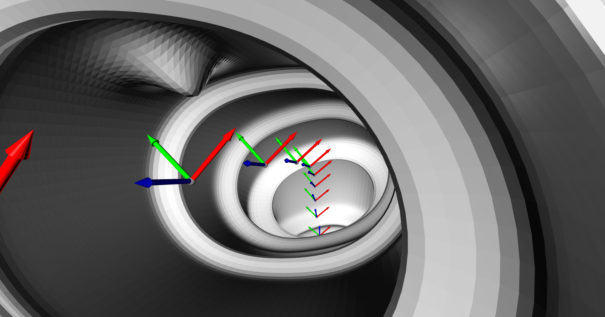
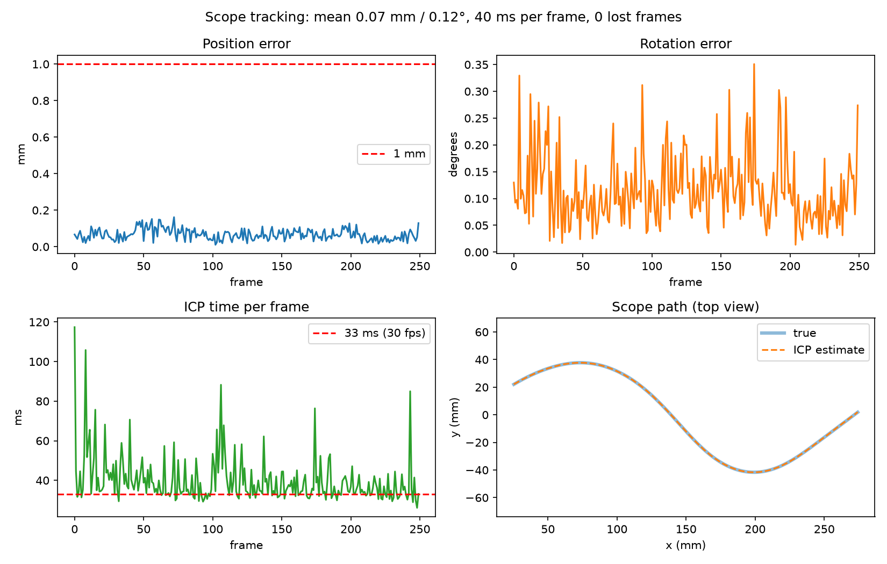

Scope - CT registration

trying to learn 3D registration. Simulating how it would be to track an endoscope inside a patients anatomy. you would have the 3D model of the patients anatomy but no way of tracking where you exist within the anatomy. 

Step 1: Building a Sample Colon 
Usually for patients a CT scan would create a 3d model of what we are trying to work with but i dont have that so im going to build a sample of a colon like a sample mesh.

  

Step 2: Creating a mock ToF camera
ToF is a time of flight camera which is a camera that uses the time a signal takes to reflect/return/flight to calculate and map out distance params. So for like LiDAR, a light ray is shot out, the distance an object is from the sensor is calculated by distance = (speed of light * time it takes to reflect back) / 2. In the context of this project, tof camera is attached to an endoscope to essentially map out the insides of a colon. I dont have a tof camera so im going to hardcode the functionality of one! Created a function that fakes the shooting of rays which is like a range grid from there I convert it to a depth map and then convert it to point cloud data

  
   
  <em>Point Cloud view of when at point 100</em>

  
   
  <em>Depth view from inside at point 100 </em>

Step 3: Mocking the movement of an actual camera moving through a colon. i dont have live video of a procedure so im going to simulate it by calculating. I add in a bit of slide, tilt and rolling to the camera for realistic variables. Essentially, every 2 points i calculate the pose (where the camera is in the colon).

  
   
  <em>Trajectory of the simulated camera path </em>

Step 4: We got what the camera sees and built a point cloud of the portion of the colon the camera is looking at. Remembering the pose of the camera is not useful if we dont know where it is in the colon making it hard to navigate. To make this functionality useful, we add in a way to use ICP to essentially map our source to target. The target in this case is the 3d model of the colon I built in step 1 and then the source is what the camera is looking at right now. Using what the camera sees we can match where it fits in the colon and find out where the camera is relative to the colon. We are registering this pose for every frame 

  
   
  <em>Plotting results of any error and the scope path and ICP time  </em>

Step 5 and 6: i plotted the error results as well as the ICP time tracking to be able to see it. Building the live viewer shows me where the camera is in the colon but also tell me how far the polyp (little bump) is from the camera so i can keep working towards it. 

https://github.com/user-attachments/assets/94b27c54-eb8a-4f17-88b0-a0fdab628588

This is the screen recording of my demo. What you see here is the point cloud of our target, the mesh colon, and then the source point cloud of the portions of the colon the camera sees. The point cloud of the source is the green "cloud" that works its way through the colon. The path of the camera can be seen through the slim blue and orange line. The red dots are the polyps, and the camera itself is represented through its pose, which 3 arrows: T, N1, and N2. 

