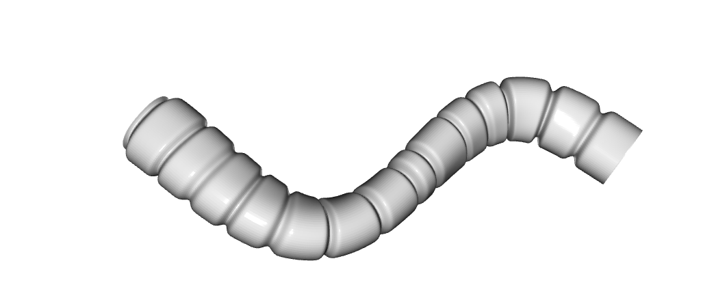
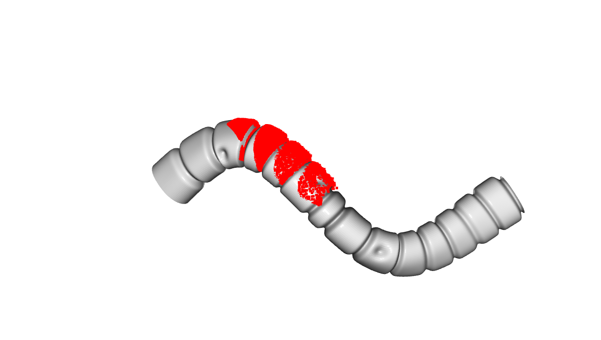
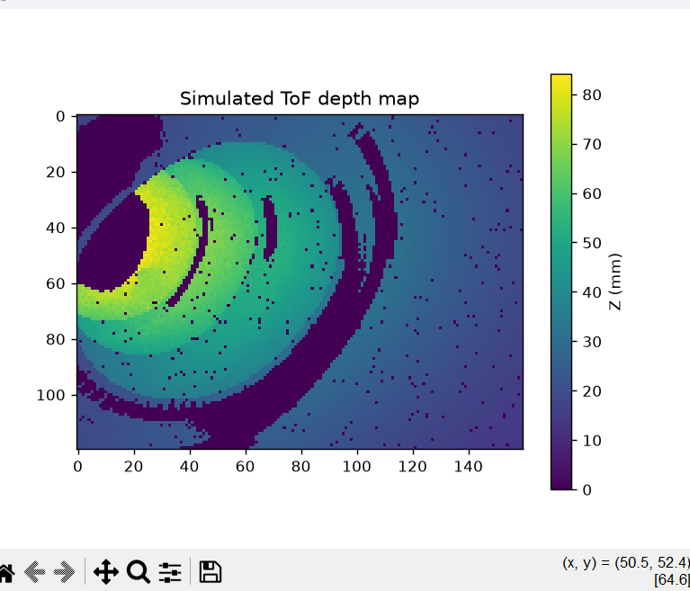

Scope - CT registration

trying to learn 3D registration. Simulating how it would be to track an endoscope inside a patients anatomy. you would have the 3D model of the patients anatomy but no way of tracking where you exist within the anatomy. 

Step 1: Building a Sample Colon 
Usually for patients a CT scan would create a 3d model of what we are trying to work with but i dont have that so im going to build a sample of a colon like a sample mesh.

  

Step 2: Creating a mock ToF camera
ToF is a time of fly camera which is a camera that uses the time a signal takes to reflect/return/fly to calculate and map out distance params. So for like LiDAR, a light ray is shot out the distance an object is from the sensor is calcualted by distance = (speed of light * time it takes to reflect back) / 2. In the context of this project, tof camera is attached to an endoscope to essentially map out the insides of a colon. I dont have a tof camera so im going to hardcore the functionality of one! Created a function that fakes the shooting of rays which is like a range grid from there I convert it to a depth map and then convert it to point cloud data

  
   
  <em>Point Cloud view of when at point 100</em>

  
   
  <em>Depth view from inside at point 100 </em>

Step 3: Mocking the movement of an actual camera moving through a colon. i dont have live video of a procedure so im going to simulate it by calculating. I add in a bit of slide, tilt and rolling to the camera for realistic variables. Essentially, every 2 points i calculate the pose (where the camera is in the colon).

  
   
  <em>Trajectory of the simulated camera path </em>

